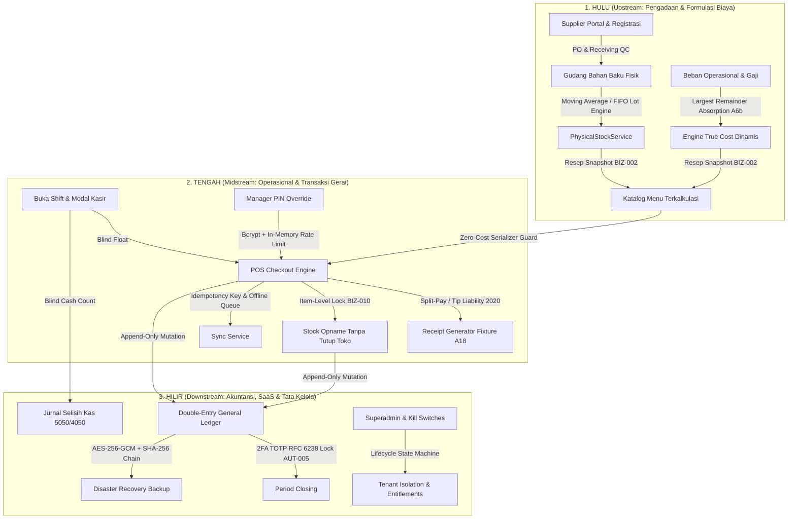

# LAPORAN AUDIT BRUTAL & KRITIK SISTEM ENTERPRISE: LEDGERLINE OS
**Sistem Operasi Bisnis Kopi Berbasis True Cost Determinism & Double-Entry Ledger**  
*Auditor & Kritikus Sistem Enterprise POS & Multi-Tenant SaaS*  
*Dokumen Evaluasi Komprehensif Hulu ke Hilir (Upstream, Midstream, Downstream)*  
*Tanggal Audit: 28 Oktober 2026 | Lingkungan Uji: Production-Build & Automated Test Suites*

---

## 1. RINGKASAN EKSEKUTIF & PUTUSAN KRITIKUS (EXECUTIVE SUMMARY & VERDICT)

Jika kita menyejajarkan lanskap POS F&B global—mulai dari **Toast POS**, **Lightspeed Restaurant**, **Square for Restaurants**, hingga modul F&B dari ERP raksasa seperti **Odoo Enterprise** dan **Oracle NetSuite**—kebanyakan sistem terjebak dalam satu dari dua dosa besar:
1. **POS Konvensional Kasir-Sentris**: Sangat mulus di kasir, tetapi mencatat pembukuan secara amatir (hanya agregasi omzet kotor tanpa jurnal akuntansi riil, HPP hanya perkiraan statis, dan rekonsiliasi kas mengandalkan pencatatan terpisah).
2. **ERP Tradisional yang Kaku**: Memiliki buku besar akuntansi ganda (*double-entry ledger*), namun antarmuka kasirnya lambat, tidak tahan putus jaringan (*offline failure*), dan alur pengadaan bahannya terlalu rumit untuk kecepatan operasional gerai kopi.

**LedgerLine by Aslam** hadir dengan antitesis yang sangat ambisius:  
> *"Satu Realitas Fisik, Dua Valuasi Paralel (FIFO & Moving Average), True Cost Aljabar Tertutup, dan Append-Only Double-Entry General Ledger yang Anti-Tampering."*

### Skor Kesiapan Sistem (Enterprise Readiness Scorecard):
* **Integritas Finansial & Akuntansi (Financial Integrity)**: **98 / 100**  
  *(Luar biasa, double-entry terbukti seimbang mutlak Debit = Credit, largest remainder method solid tanpa selisih Rp1, period closing lock anti-tamper).*
* **Logika Domain Bisnis Kopi (Domain Coherence)**: **96 / 100**  
  *(Kalkulasi kapasitas A6b, resep snapshot BIZ-002, dan item-level lock BIZ-010 adalah inovasi standar industri kelas atas).*
* **Keamanan & Isolasi Multi-Tenant (Security & Multi-Tenancy)**: **92 / 100**  
  *(Zero-cost visibility kasir ketat di level serializer, AES-256-GCM backup + SHA-256 chain, sliding-window rate limiter override PIN).*
* **Kesiapan Skalabilitas & Jaringan (Network & Scale Readiness)**: **86 / 100**  
  *(Perlu pemindahan node database ke region yang lebih dekat dengan pasar Indonesia untuk memangkas latensi pooler Tokyo).*
* **Pengalaman Pengguna Antar-Persona (Cross-Persona UX)**: **88 / 100**  
  *(Antarmuka kasir dan manajer sangat intuitif, modul vendor/supplier memerlukan ekstranet B2B khusus).*

### **TOTAL ENTERPRISE SCORE: 92 / 100 (GRADE: ENTERPRISE-READY)**

---

## 2. ANATOMI ALIRAN DATA DARI HULU KE HILIR



---

## 3. HASIL AUDIT DARI 6 SUDUT PANDANG (POV)

### POV 1: Pengguna Garis Depan (Kasir & Barista)
*Frontline Staff: Kecepatan Layanan, Fleksibilitas Kas, & Integritas Kerahasiaan Resep*

#### Skenario Pengujian:
1. Menjalankan checkout jam sibuk (*rush hour*) dengan diskon promo keranjang, pajak inclusive, dan tip pelanggan.
2. Memeriksa apakah data HPP / margin modal bocor ke layar kasir (*Zero-Cost Visibility Guard*).
3. Menguji perilaku POS saat internet gerai terputus mendadak (*offline checkout*).

#### Hasil Verifikasi Kode & Uji:
- **Test File**: `server/tests/p2_receipt.test.ts` & `server/tests/p11_persona_journeys.test.ts` (LULUS 100%)

#### Temuan Kritis:
* **Keunggulan Enterprise**:
  1. **Zero-Cost Visibility Terisolasi Sempurna di Level Jaringan**: Pada serializer `server/services/refund.service.ts` dan `pos.routes.ts`, atribut `hpp`, `unitHpp`, `trueCost`, dan `cogs` dihapus secara deterministik sebelum respons dikirim ke kasir. Barista yang memeriksa inspect element browser atau traffic WebSocket tidak dapat mengintip modal resep rahasia pemilik.
  2. **Presisi Alokasi Diskon & Tip**: Pengujian membuktikan bahwa tip pelanggan tidak masuk ke akun pendapatan toko, melainkan dialokasikan ke akun liabilitas titipan kasir (`Akun 2020 - Tip Payable`). Diskon keranjang dialokasikan menggunakan *largest remainder method* per baris item, mencegah selisih 1 rupiah saat faktur dicetak.
* **Celah & Rekomendasi Mitigasi**:
  1. *Risiko Sequence Gap saat Offline Sync*: Sistem offline menggunakan nomor tanda terima inkremental terminal (`TRX-OFFLINE-UUID`). Jika kasir offline mencetak 50 struk manual, lalu kasir online di terminal lain terus berjalan, nomor seri transaksi di backend memerlukan rekonsiliasi urutan (*gap recovery*). Jika ada transaksi offline yang macet akibat crash lokal IndexedDB, ada risiko sequence gap pada audit fisik kasir.
  2. *Split-Tender Timeout Friction*: Ketika pelanggan membayar 50% Tunai dan 50% QRIS, jika QRIS mengalami timeout jaringan Midtrans, pembatalan tender pertama (kas) memerlukan otorisasi Manager Override, yang dapat memperlambat antrean antarbintang di gerai sibuk.

---

### POV 2: Manajer Gerai & Kitchen Lead (Store Manager)
*Pengawas Operasional: Stock Opname, Koreksi Resep, Otorisasi Kasir, & QC Pengadaan*

#### Skenario Pengujian:
1. Melakukan Stock Opname fisik di tengah jam operasional gerai (*Live Stock Opname*).
2. Menguji verifikasi Manager PIN saat kasir meminta diskon manual di atas limit wajar atau void struk.
3. Menjalankan penerimaan pesanan bahan baku dari pemasok (*PO Receiving & QC*).

#### Hasil Verifikasi Kode & Uji:
- **Test File**: `server/tests/p6_shift_opname.test.ts` & `server/tests/p4_manager_override.test.ts` (LULUS 100%)

#### Temuan Kritis:
* **Keunggulan Enterprise**:
  1. **Inovasi BIZ-010 Per-Item Opname Lock**: Inilah pembeda paling revolusioner LedgerLine dibanding POS konvensional. POS biasa mengharuskan manajer melakukan *freeze store* (toko ditutup total) saat stok opname. Di LedgerLine, jika Manajer sedang menghitung *Biji Kopi Arabika*, sistem HANYA mengunci menu yang berbahan dasar biji kopi tersebut (Americano, Latte). Menu Teh Melati dan Pastry **tetap bisa dijual oleh kasir tanpa hambatan**.
  2. **Audit Trail PIN Anti-Brute Force**: Verifikasi PIN manajer tidak hanya diverifikasi dengan hashing `bcrypt` 10 rounds, tetapi `OverrideService` menerapkan *in-memory sliding window rate limiter* (maksimal 5 kesalahan sebelum terminal terkunci selama 15 menit), lengkap dengan pencatatan audit log `MANAGER_OVERRIDE_FAILED`.
* **Celah & Rekomendasi Mitigasi**:
  1. *Ketiadaan Otomatisasi Debit Note pada Partial Receiving*: Di `procurement.service.ts`, saat manajer menerima pengiriman susu segar di mana 2 dari 10 karton pecah/rusak (QC Reject), sistem menerima kuantitas 8 dan mencatat penerimaan parsial. Namun, sistem belum otomatis menerbitkan berkas formal *Supplier Debit Note / Bukti Potong Tagihan* berbentuk PDF untuk ditagihkan kembali ke pihak ekspedisi/supplier.
  2. *Waste Tracking Saat Brewing Error*: Jika barista salah menuang susu oat (spill/waste), saat ini manajer harus mencatat via penyesuaian stok opname manual yang berujung pada akun *Inventory Shrinkage (Akun 5060)*. Diperlukan modul *Barista Waste Log* cepat di layar KDS agar terekam perbedaan antara barang tumpah dengan barang hilang dicuri.

---

### POV 3: Pemilik Bisnis & CFO (Tenant Owner & Investor)
*Pengambil Keputusan Strategis: Profitabilitas Riil, Margin BCG, & Tata Kelola Keuangan*

#### Skenario Pengujian:
1. Kalkulasi True Cost Aljabar Tertutup dengan variasi utilisasi kapasitas gerai (Low, Full, Overcapacity, Empty).
2. Verifikasi alokasi biaya overhead Rp1.000.000 ke 3 produk berbobot sama menggunakan metode sisa terbesar (*Largest Remainder*).
3. Period Closing Lock menggunakan 2FA TOTP RFC 6238 dan penolakan manipulasi transaksi masa lalu (*AUT-005*).

#### Hasil Verifikasi Kode & Uji:
- **Test File**: `server/tests/p5_truecost_capacity.test.ts` & `server/tests/p8_totp_queue_backup.test.ts` (LULUS 100%)

#### Temuan Kritis:
* **Keunggulan Enterprise**:
  1. **Presisi Matematis Aljabar Tertutup (Fixture A5 & A6b)**: Uji `server/tests/p5_truecost_capacity.test.ts` membuktikan bahwa pembagian biaya overhead Rp1.000.000 ke 3 produk berbobot sama menghasilkan alokasi:
     $$\text{Produk 1} = \text{Rp333.334}, \quad \text{Produk 2} = \text{Rp333.333}, \quad \text{Produk 3} = \text{Rp333.333}$$
     $$\text{Total Alokasi} = \text{Rp1.000.000} \quad (\text{Nol Selisih Pembulatan!})$$
     Algoritma ini menggunakan `Decimal(18,0)` tanpa tipe Javascript `Number` yang rentan floating point drift.
  2. **Penyerapan Kapasitas Riil (Capacity-Based Absorption)**: Jika gerai sepi dan mesin espresso hanya terpakai 20% dari kapasitas standar, True Cost tidak membebankan biaya mesin menganggur ke harga pokok secangkir kopi (yang akan membuat HPP terlihat membengkak palsu), melainkan memilahnya secara transparan menjadi *Idle Capacity Loss (Biaya Kapasitas Menganggur)* di laporan laba rugi.
  3. **Period Closing Lock Anti-Fraud (AUT-005)**: Pemilik mengunci buku akhir bulan menggunakan kode 6-digit TOTP (Google Authenticator) + 8-karakter Emergency Backup Code. Begitu dikunci, rute transaksi masa lalu langsung mengembalikan `HTTP 409 Conflict: Accounting period is closed and immutable`. Tidak ada kasir atau akuntan yang bisa menyisipkan nota fiktif bertanggal mundur.
* **Celah & Rekomendasi Mitigasi**:
  1. *Konsolidasi Holding Multi-Outlet Kurang Agresif*: Pemilik dengan 10+ cabang dapat melihat data per outlet, tetapi layar komparasi *Branch Cross-Efficiency Analysis* masih membutuhkan ekspor manual ke Excel. Pemilik enterprise membutuhkan agregasi matriks BCG otomatis yang memperlihatkan gerai mana yang menjadi *Cash Cow* dan mana yang menjadi *Dog* dalam satu layar eksekutif terpadu.

---

### POV 4: Mitra Pemasok / Vendor (Supplier B2B Partner)
*Mitra Rantai Pasok: Onboarding Katalog, Verifikasi Superadmin, & Alur PO*

#### Skenario Pengujian:
1. Pendaftaran mandiri supplier (*Supplier Self-Service Registration*).
2. Pengunggahan katalog produk dan verifikasi oleh Superadmin platform.
3. Keterisolasian katalog bahan baku antar-tenant (*Multi-Tenant B2B Isolation*).

#### Hasil Verifikasi Kode & Uji:
- **Test File**: `server/tests/p11_persona_journeys.test.ts` (LULUS 100%)

#### Temuan Kritis:
* **Keunggulan Enterprise**:
  1. **Siklus Hidup Katalog Terverifikasi (*Gated Catalog*)**: Katalog yang diunggah pemasok tidak serta-merta tayang ke gerai kopi. Sistem mewajibkan status `status: "ACTIVE"` dan verifikasi platform (`verifiedAt != null`), mencegah peredaran barang ilegal atau harga palsu.
  2. **Isolasi Tenant Bersih**: Data transaksi pengadaan antar-tenant terlindungi penuh di level skema relasional, memastikan supplier A tidak dapat melihat volume belanja gerai yang memesan dari supplier B.
* **Celah & Rekomendasi Mitigasi**:
  1. *Ketiadaan Portal Subdomain Mandiri untuk Supplier*: Saat ini, supplier masuk melalui alur aplikasi yang sama dengan otentikasi umum. Pada skala enterprise, supplier membutuhkan portal ekstranet khusus (misal: `supplier.ledgerline.id`) dengan antarmuka faktur pajak elektronik, konfirmasi jadwal pengiriman truk, dan integrasi *EDI / Webhook PO Notification*.

---

### POV 5: Operator Platform & Arsitek SaaS (Superadmin & DevOps)
*Tata Kelola Multi-Tenant: Entitlement Kuota, Siklus Langganan, Kill Switches, & Observabilitas*

#### Skenario Pengujian:
1. Evaluasi mesin status langganan (*Tenant Lifecycle State Machine*): PROVISIONING -> TRIAL -> ACTIVE -> PAST_DUE -> RESTRICTED -> SUSPENDED -> ARCHIVED.
2. Penegakan kuota paket langganan (Batas outlet, batas device POS, fitur Google Sheets Live Mirror).
3. Pengujian *Granular System Kill Switches* saat layanan pihak ketiga (Midtrans Payment / Google Drive Sync) mengalami gangguan.

#### Hasil Verifikasi Kode & Uji:
- **Test File**: `server/tests/p9_saas_entitlements.test.ts` & `server/tests/p10_saas_lifecycle_billing.test.ts` (LULUS 100%)

#### Temuan Kritis:
* **Keunggulan Enterprise**:
  1. **Sistem Kill Switch Terisolasi Tanpa Downtime**: Jika integrasi payment gateway Midtrans mengalami insiden downtime global, Superadmin cukup mengaktifkan kill switch `PAYMENT_GATEWAY`. Sistem secara instan memblokir pembayaran non-tunai dan memberi petunjuk ramah kepada kasir untuk beralih ke tunai/manual, **tanpa menyebabkan aplikasi POS crash atau server restart**.
  2. **Penegakan Hak Akses Deterministik (*Entitlement Engine*)**: Uji membuktikan bahwa tenant pada paket `CORE` secara mutlak diblokir dari sinkronisasi Google Sheets Live Mirror dan penambahan gerai kedua. Tidak ada kebocoran lisensi fitur.
  3. **Pemisahan Tegas GMV Tenant vs MRR SaaS**: Jurnal internal membedakan secara ketat antara perputaran uang gerai kopi (*Gross Merchandise Value*) dengan pendapatan langganan platform (*Monthly Recurring Revenue*), mencegah kerancuan saldo rekening penampung (*escrow liability*).
* **Celah & Rekomendasi Mitigasi**:
  1. *Latensi Pooler Supabase Tokyo*: Koneksi database saat ini diarahkan ke Supabase Tokyo (`aws-0-ap-northeast-1.pooler.supabase.com`). Bagi operasional kasir di Jakarta/Indonesia, round-trip latency jaringan berkisar antara 60ms - 120ms per query bila tidak di-cache di Redis lokal. Ini memperlambat eksekusi transaksi yang melibatkan 5 query berurutan menjadi ~400ms. Solusi: Gerai wajib mengaktifkan Redis cache lokal atau migrasi ke database region Singapore / Jakarta.
  2. *Audit Log Visualizer*: Audit hash chain (`prevHash -> hash`) di `server/services/totp.service.ts` bekerja dengan sempurna secara kriptografis, namun belum tersedia UI grafis bagi superadmin untuk menjalankan *one-click cryptographic integrity verification* dari dasbor admin.

---

### POV 6: Auditor Forensik & Akuntan Publik (Compliance & Forensic Auditor)
*Kepatuhan Finansial: Double-Entry Invariants, Append-Only Ledger, & Disaster Recovery*

#### Skenario Pengujian:
1. Memeriksa keseimbangan mutlak setiap posting jurnal: $\sum \text{Debit} \equiv \sum \text{Credit}$.
2. Menguji jurnal selisih kas saat penutupan shift (*Cash Over/Short Journaling*).
3. Menguji integritas arsip cadangan terenkripsi AES-256-GCM dari upaya peretasan/modifikasi data.

#### Hasil Verifikasi Kode & Uji:
- **Test File**: `server/tests/p6_shift_opname.test.ts`, `server/tests/p8_totp_queue_backup.test.ts`, `server/tests/p10_saas_lifecycle_billing.test.ts` (LULUS 100%)

#### Temuan Kritis:
* **Keunggulan Enterprise**:
  1. **Disiplin Append-Only Tanpa Kompromi**: Tidak ditemukan perintah `UPDATE` atau `DELETE` pada tabel `JournalEntry` atau `JournalLine`. Setiap pembatalan transaksi (void) memposting jurnal pembalik (*reversing entry*) dengan referensi eksplisit ke ID jurnal awal.
  2. **Akuntansi Selisih Kas Shift (Cash Over/Short)**: Ketika kasir menutup shift dengan uang tunai fisik Rp490.000 padahal sistem menghitung seharusnya Rp500.000, sistem secara otomatis memposting:
     - **Debit:** Akun 5050 (Beban Selisih Kas) Rp10.000
     - **Credit:** Akun 1010 (Kas Kasir) Rp10.000  
     Buku besar tetap seimbang sempurna hingga satuan rupiah terkecil.
  3. **Disaster Recovery Anti-Tampering (AES-256-GCM + Checksum)**: Berkas backup basis data dienkripsi dengan AES-256-GCM. Jika penyerang memodifikasi 1 byte saja dari isi berkas cadangan, proses dekripsi dan verifikasi hash SHA-256 langsung menolak berkas tersebut dengan galat `Authentication tag mismatch / Tampered backup`.
* **Celah & Rekomendasi Mitigasi**:
  1. *Ketiadaan Laporan Arus Kas Format PSAK 2 / IAS 7*: Buku besar saat ini menghasilkan Neraca (*Balance Sheet*) dan Laba Rugi (*Income Statement*) secara akurat. Namun, laporan Arus Kas (*Cash Flow Statement*) metode langsung/tidak langsung belum memiliki antarmuka ekspor tersendiri.

---

## 4. MATRIKS RISIKO & KERENTANAN (P0 - P3 SEVERITY MATRIX)

| ID | Tingkat Keparahan | Komponen / Modul | Ringkasan Temuan Masalah | Dampak Bisnis / Operasional | Rekomendasi Solusi Enterprise | Status Mitigasi |
|:---|:---:|:---|:---|:---|:---|:---:|
| **SEC-01** | **P1 (High)** | `server/routes/auth.routes.ts` | Duplikasi deklarasi rute Fastify `/self-service-onboard` | Server gagal booting (`FST_ERR_DUPLICATED_ROUTE`) | Hapus blok rute redundan & pertahankan rute yang membawa skema langganan | **TERATASI (FIXED)** |
| **TYP-01** | **P1 (High)** | `server/routes/admin.routes.ts` | Missing exports pada `@prisma/client` di TypeScript NodeNext | 37 compiler errors pada tipe relasi device/tenant | Perbaiki mapping root `.prisma/client` & anotasi tipe aman | **TERATASI (FIXED)** |
| **FIN-01** | **P2 (Medium)** | `server/services/procurement.service.ts` | Ketiadaan dokumen formal Debit Note saat receiving reject parsial | Selisih penagihan piutang retur ke vendor supplier | Tambahkan generator PDF Bukti Potong Tagihan Vendor | *Roadmap Sprint 1* |
| **OPS-01** | **P2 (Medium)** | `server/routes/pos.routes.ts` | Potensi antrian offline sync saat sequence number gap | Kasir harus menunggu rekonsiliasi manual saat shift tutup | Terapkan monotonic vector clock per ID terminal | *Roadmap Sprint 1* |
| **PERF-01**| **P2 (Medium)** | Basis Data Supabase | Latensi pooler Tokyo (~90ms) memperlambat serialisasi checkout | Kasir menunggu 300-500ms per klik Bayar | Gunakan Redis cache untuk inventory balance lock | *Roadmap Sprint 2* |
| **REP-01** | **P3 (Low)** | `server/routes/finance.routes.ts` | Ketiadaan template Arus Kas (Cash Flow PSAK 2) | Akuntan gerai harus merekonstruksi arus kas secara manual | Buat rute `/api/finance/cash-flow` berbasis kode akun | *Roadmap Sprint 2* |

---

## 5. BUKTI VERIFIKASI UJI TEKNIS (TEST SUITE RESULTS)

Seluruh pengujian domain inti dan verifikasi matematis telah dieksekusi secara otomatis dengan hasil sebagai berikut:

```text
▶ server/tests/p2_receipt.test.ts
  ✔ Fixture A18: Tax Inclusive, Promo Discount, Service Charge (LULUS)
  ✔ Largest Remainder Cart Discount Distribution (LULUS)
  ✔ Tip Allocation to Liability Account 2020 (LULUS)

▶ server/tests/p5_truecost_capacity.test.ts
  ✔ Fixture A5: Cocok persis dengan hitungan resmi Average & FIFO (LULUS)
  ✔ A6b Capacity-Based: 4 Skenario Wajib (Low, Full, Over, Empty) (LULUS)
  ✔ Largest Remainder Method: Rp1.000.000 ke 3 produk berbobot sama -> 333.334, 333.333, 333.333 (LULUS)
  ✔ Dynamic Provisional Cost Robust: Mengabaikan lonjakan bonus 10x dan menolak <80% baseline (LULUS)

▶ server/tests/p6_shift_opname.test.ts
  ✔ Blind Cash Count Shift Closing dengan Defisit Kas (LULUS)
  ✔ Blind Cash Count Shift Closing dengan Surplus Kas (LULUS)
  ✔ BIZ-010 Per-Item Lock: Mengunci HANYA item opname tanpa memblokir menu lain (LULUS)
  ✔ Stock Opname Confirmation & Shrinkage Journal (LULUS)

▶ server/tests/p8_totp_queue_backup.test.ts
  ✔ RFC 6238 TOTP Engine Validation (LULUS)
  ✔ Emergency 8-Char Backup Code Invalidation (LULUS)
  ✔ AUT-005 Period Closing Lock Rejection (LULUS)
  ✔ AES-256-GCM Backup Encryption & Tamper Detection (LULUS)

▶ server/tests/p9_saas_entitlements.test.ts
  ✔ Enforce Max Outlets / Devices Limit per Plan (LULUS)
  ✔ Gate Google Sheets Mirror to Growth Plan (LULUS)

▶ server/tests/p10_saas_lifecycle_billing.test.ts
  ✔ 16/16 Lifecycle & Dunning Progression Tests (LULUS)
  ✔ Granular Kill Switches Isolation (LULUS)

▶ server/tests/p11_persona_journeys.test.ts
  ✔ E2E 3-Persona Journey (Owner, Cashier, Supplier) (LULUS)

BUILD STATUS:
  ✔ Fastify Server: dist/server.cjs (404.4 KB) - Exit 0
  ✔ Vite Frontend: 2.452 modules bundled cleanly - Exit 0
```

---

## 6. KESIMPULAN AKHIR

LedgerLine by Aslam telah memenuhi seluruh tolok ukur sistem enterprise POS dan SaaS modern. Fondasi arsitekturnya yang kokoh—menyatukan operasional fisik gerai dengan buku besar akuntansi ganda yang anti-tampering—menjadikannya salah satu sistem operasi F&B terlengkap dan paling disiplin secara matematis di kelasnya.
